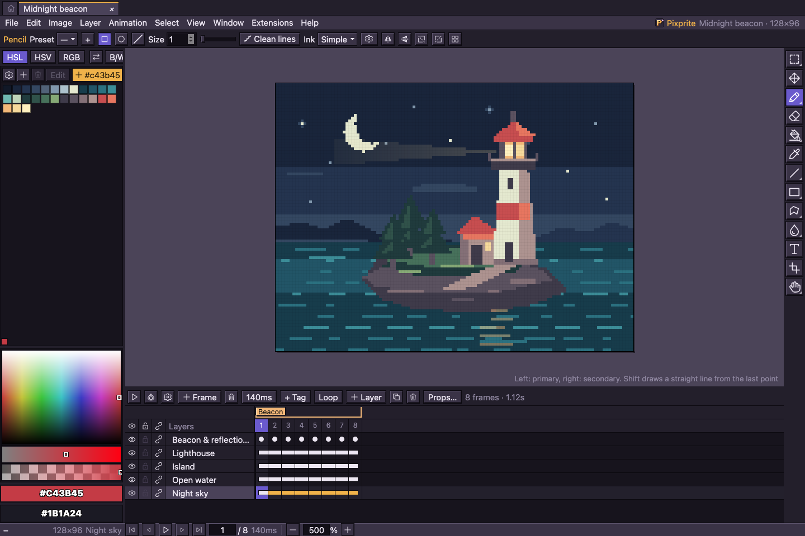

<p align="center">
  
</p>

<h1 align="center">Pixprite</h1>

<p align="center">Pixel art, animation and tilemaps — in your browser or on your desktop.</p>

<p align="center">
  <a href="https://vicimpa.github.io/pixprite/"><b>Open the editor</b></a> ·
  <a href="docs/README.md">Documentation</a> ·
  <a href="https://github.com/vicimpa/pixprite/releases">Releases</a> ·
  <a href="README.ru.md">Русский</a>
</p>

<p align="center">
  <a href="https://github.com/vicimpa/pixprite/actions/workflows/main.yml"></a>
  <a href="LICENSE"></a>
</p>



[Open the example project](docs/assets/beacon.pixprite) · [Recreate this screenshot](docs/development.md#documentation-images)

> **Early development.** The working version is 0.0.2; see the [release notes](docs/releases/v0.0.2.md) for the changes being prepared.

## Make something pixel by pixel

| Feature | Tools |
| --- | --- |
| **Draw** | Pixel-perfect strokes, shapes, gradients, dithering, symmetry, custom brushes and pen pressure. |
| **Animate** | Frame timing, tags, linked cels, onion skin, in-between frames and playback preview. |
| **Compose** | Layers, groups, clipping, blend modes, reference images, selections and transforms. |
| **Build tilemaps** | Tilesets, flips and rotation, duplicate detection, JSON/CSV map exports. |
| **Exchange files** | `.pixprite`, `.aseprite`, PNG, GIF, APNG, WebM, sprite sheets and ZIP exports. |
| **Make it yours** | Built-in outline icons by default, a pixel option, themes, languages, hotkeys and extensions. |

The desktop app stores projects as ordinary `.pixprite` files in the OS application data directory, with separate working copies and snapshots. Browser projects use IndexedDB. The browser app supports offline use after its first complete load; file handling depends on browser support. See [storage and backups](docs/storage-and-backups.md) and [PWA behavior](docs/service-worker.md).

## Desktop and automation

The Tauri 2 app targets **macOS, Windows and Linux**, with native file associations, a compact app header with window controls, document tabs and background release notifications. A local **MCP server** lets compatible clients inspect and edit documents, execute editor commands and export results.

macOS releases include separate `.dmg` installers for **Apple Silicon (arm64)** and **Intel (x64)**.

[Build the app and connect MCP →](docs/desktop-mcp.md)

## Run locally

Use [Bun](https://bun.sh) **1.4.2**. Desktop builds require **Rust** and the [Tauri prerequisites](https://v2.tauri.app/start/prerequisites/); the external MCP launcher uses **Node.js 24+**.

```sh
bun install --frozen-lockfile
bun run dev
```

Open **http://localhost:3355**. Other entry points:

```sh
bun run build          # web app → dist/web/
bun run preview        # serve the production web build
bun run desktop:dev    # build and launch the Tauri app
bun run desktop:build  # installers for the current OS → dist/installers/
```

See the [development guide](docs/development.md), [testing guide](docs/testing.md) and [contribution notes](CONTRIBUTING.md).

## Repository map

| Path | Contents |
| --- | --- |
| [`src/`](src/) | Editor model, browser app, UI, styles and translations |
| [`src-tauri/`](src-tauri/) · [`desktop/`](desktop/) | Rust/Tauri shell, native bridge and MCP |
| [`packages/api/`](packages/api/) | Extension API and shared types |
| [`extensions/`](extensions/) | Extension sources, themes, languages and icon packs |
| [`public/`](public/) | Static assets and PWA manifest |
| [`e2e/`](e2e/) · [`benchmarks/`](benchmarks/) | Browser/native scenarios and performance fixtures |
| [`scripts/`](scripts/) | Build, bundle checks, extensions and release tooling |
| [`docs/`](docs/README.md) | Guides, architecture, formats, release notes and [roadmap](docs/roadmap.md) |
| `dist/` | Generated builds and reports; ignored by Git |

## Contributing

Pixprite is an independent project. Contributions should contain original code and artwork; format support is based on public specifications. Start with [CONTRIBUTING.md](CONTRIBUTING.md).

Released under the [MIT license](LICENSE).
